<div align="center">

# Prediksi Gaji Tahunan Profesional Data, AI, dan Teknologi
### Final Project — Machine Learning (IT6043) · Kelompok GodBless

[](https://www.python.org/)
[](https://scikit-learn.org/)
[](https://pandas.pydata.org/)
[](https://streamlit.io/)

**Program Studi Informatika — Fakultas Teknologi Informasi**  
**Universitas Kristen Duta Wacana (UKDW), Yogyakarta**  
*Semester Gasal 2026/2027*

---

</div>

## 1. Identitas Kelompok (GodBless)

| No | NIM | Nama Lengkap | Peran & Kontribusi Utama |
|:---:|:---:|:---|:---|
| 1 | **71231042** | **Revaldo Fransisco Hohary** | Eksplorasi Data (EDA), analisis statistik deskriptif, dan penyusunan dokumen laporan |
| 2 | **71231050** | **Samuel Natanael** | Perancangan pipeline pre-processing, pelatihan & komparasi model ML, pengembangan GUI Streamlit, serta manajemen repositori GitHub |
| 3 | **71241154** | **Indira Mai Narwastu** | Kurasi dataset, *feature engineering*, evaluasi metrik regresi, dan visualisasi data |

---

## 2. Deskripsi Proyek & Latar Belakang

Pertumbuhan pesat industri *Data Science*, *Artificial Intelligence* (AI), dan *Machine Learning* secara global menciptakan variasi kompensasi yang sangat lebar berdasarkan tingkat pengalaman, lokasi geografis perusahaan, ukuran organisasi, serta skema kerja (*On-site*, *Hybrid*, *Remote*).

Proyek akhir ini bertujuan untuk membangun **sistem prediksi gaji tahunan dalam satuan USD (`salary_in_usd`)** menggunakan pendekatan *Supervised Machine Learning* (Regresi) yang terintegrasi dengan antarmuka web interaktif berbasis **Streamlit**.

### Manfaat Sistem
- **Bagi Pencari Kerja & Profesional Teknologi:** Memberikan acuan estimasi kompensasi yang objektif saat bernegosiasi gaji berdasarkan profil pekerjaan dan lokasi perusahaan.
- **Bagi Perekrut & HR (*Talent Acquisition*):** Membantu penyusunan standar remunerasi (*salary benchmarking*) yang kompetitif di pasar global maupun regional.

---

## 3. Arsitektur Sistem & Alur Pemrosesan (ML Pipeline)

```mermaid
flowchart LR
    A["Dataset Global AI/ML Salaries<br/>(71.913 Observasi Bersih)"] --> B["Data Cleaning & Leakage Prevention<br/>(Drop salary, currency, outlier_flag)"]
    B --> C["Feature Engineering<br/>(is_us_company, same_country)"]
    C --> D["Target Transformation<br/>y = log1p(salary_in_usd)"]
    D --> E["ColumnTransformer Pipeline<br/>Ordinal + OneHot + StandardScaler"]
    E --> F["Komparasi Model Regresi<br/>Ridge vs Random Forest vs HistGBM"]
    F --> G["Model Terbaik (model.pkl)<br/>HistGradientBoostingRegressor"]
    G --> H["Aplikasi Client Streamlit<br/>(app.py / prediksiGaji.py)"]
```



---

## 4. Dataset & Karakteristik Fitur

- **Sumber Dataset:** [aijobs.net Global AI, ML, Data Science Salary Index](https://aijobs.net/salaries/) (Lisensi CC0 Public Domain).
- **Volume Data Bersih:** **71.913 baris observasi unik** dan **17 kolom** pada `Proposal/ai_jobs_salaries_clean.csv` (0 duplikat).
- **Variabel Target:** `salary_in_usd` (Kontinu, rentang \$15.000 – \$800.000, *Mean* = \$150.299, *Median* = \$142.200, *Skewness* = `1.48`).

### Fitur Input Model & *Feature Engineering*
| Nama Fitur | Tipe | Penanganan Pre-processing | Deskripsi |
|:---|:---:|:---|:---|
| `work_year` | Numerik | `StandardScaler` | Tahun pencatatan gaji (`2020` – `2025`) |
| `experience_level` | Ordinal | `OrdinalEncoder` (`EN < MI < SE < EX`) | Tingkat senioritas: Entry (`EN`), Mid (`MI`), Senior (`SE`), Executive (`EX`) |
| `company_size` | Ordinal | `OrdinalEncoder` (`S < M < L`) | Ukuran perusahaan: Kecil (`S`), Menengah (`M`), Besar (`L`) |
| `employment_type` | Kategorikal | `OneHotEncoder` | Jenis kontrak: Full-time (`FT`), Part-time (`PT`), Contract (`CT`), Freelance (`FL`) |
| `job_title` | Kategorikal | `OneHotEncoder` (`min_frequency=20`) | Jabatan spesifik (`Data Scientist`, `ML Engineer`, `AI Engineer`, dll.) |
| `employee_residence` | Kategorikal | `OneHotEncoder` (`min_frequency=20`) | Kode ISO negara domisili pekerja |
| `company_location` | Kategorikal | `OneHotEncoder` (`min_frequency=20`) | Kode ISO negara lokasi perusahaan |
| `remote_ratio` | Numerik | `StandardScaler` | Rasio kerja jarak jauh (`0` = On-site, `50` = Hybrid, `100` = Remote) |
| `is_us_company` | Biner (Turunan) | `StandardScaler` | Bernilai `1` jika perusahaan berlokasi di Amerika Serikat (`US`), `0` jika bukan |
| `same_country` | Biner (Turunan) | `StandardScaler` | Bernilai `1` jika lokasi perusahaan sama dengan domisili pekerja |

> **Pencegahan *Data Leakage*:** Kolom `salary`, `salary_currency`, dan `salary_outlier_flag` dihapus sebelum pelatihan karena memiliki hubungan deterministik langsung dengan target `salary_in_usd`.

---

## 5. Hasil Eksperimen & Komparasi Model Regresi

Seluruh model dievaluasi menggunakan skema pembagian **80% Data Latih (57.530 baris)** dan **20% Data Uji (14.383 baris)** (`random_state=42`) dengan transformasi target $\log(1 + y)$:

| No | Algoritma Regresi | $R^2$ Score (Log Space) | MAE (USD) | RMSE (USD) | Keterangan |
|:---:|:---|:---:|:---:|:---:|:---|
| 1 | **Ridge Regression** (`alpha=10.0`) | `0.4006` | \$46,381.58 | \$67,013.49 | Baseline linear dengan regularisasi $L_2$ |
| 2 | **Random Forest Regressor** (`n_estimators=100, max_depth=16`) | `0.3855` | \$47,073.02 | \$67,651.34 | Ensemble bagging pohon keputusan |
| 3 | **Gradient Boosting (`HistGradientBoostingRegressor`)** | **`0.4134`** | **\$46,094.36** | **\$66,523.78** | **Model Terbaik** (Disimpan ke `model.pkl`) |

---

## 6. Struktur Direktori Repositori

```text
├── app.py                                   # Aplikasi Web Interaktif (Streamlit GUI) di root
├── train_model.py                           # Skrip pelatihan, evaluasi 3 model, dan ekspor model.pkl
├── model.pkl                                # Pipeline model terbaik (ColumnTransformer + HistGBM)
├── requirements.txt                         # Daftar dependensi pustaka Python
├── README.md                                # Dokumentasi utama repositori GitHub
├── .gitignore                               # Konfigurasi berkas yang diabaikan Git
├── Proposal/
│   ├── Proposal Final Project.pdf           # Dokumen Proposal Final Project Kelompok GodBless
│   ├── analisis_dataset.ipynb               # Jupyter Notebook Eksplorasi Data (EDA) & Visualisasi
│   ├── ai_jobs_salaries_clean.csv           # Dataset bersih hasil kurasi (71.913 baris x 17 kolom)
│   └── prediksiGaji.py                      # Skrip aplikasi Streamlit pada direktori Proposal
├── DatasetDanCode/
│   ├── salaries.csv                         # Dataset mentah aijobs.net (2020-2025)
│   ├── README.md                            # Dokumentasi asli sumber dataset aijobs.net
│   └── LICENSE                              # Lisensi CC0 1.0 Public Domain
└── TemplateLaporan/
    └── TEMPLATE_LAPORAN_AKHIR_PROJECT_-_ML.docx
```

---

## 7. Panduan Instalasi & Cara Menjalankan

### 1. Clone Repositori
```bash
git clone https://github.com/SamuelN1508/FinalProject-ML-GodBless.git
cd FinalProject-ML-GodBless
```

### 2. Instalasi Dependensi
Pastikan Python 3.9+ telah terpasang, lalu instal seluruh pustaka yang dibutuhkan:
```bash
pip install -r requirements.txt
```

### 3. Melatih Ulang Model (Opsional)
Berkas `model.pkl` sudah disertakan di dalam repositori. Jika ingin menjalankan ulang pelatihan dan melihat tabel perbandingan metrik di terminal:
```bash
python train_model.py
```

### 4. Menjalankan Aplikasi Web Prediksi Gaji (Streamlit)
```bash
streamlit run app.py
```
*(Aplikasi akan otomatis terbuka di browser pada alamat `http://localhost:8501`)*

### 5. Membuka Notebook Eksplorasi Data (EDA)
```bash
jupyter notebook Proposal/analisis_dataset.ipynb
```

---

<div align="center">
<sub>Final Project IT6043 Machine Learning — Kelompok GodBless · FTI UKDW 2026</sub>
</div>
